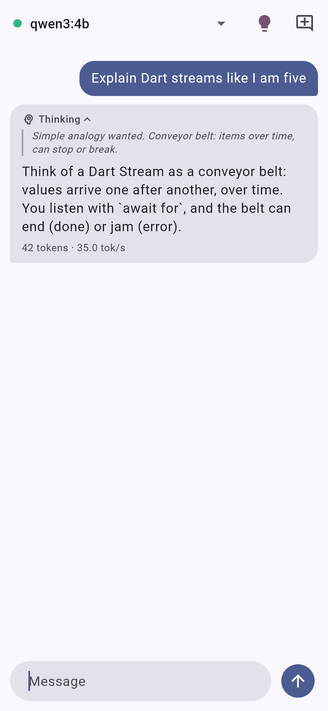
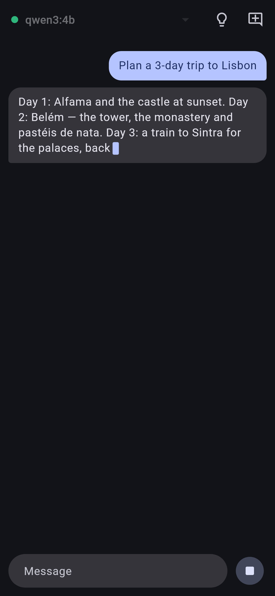
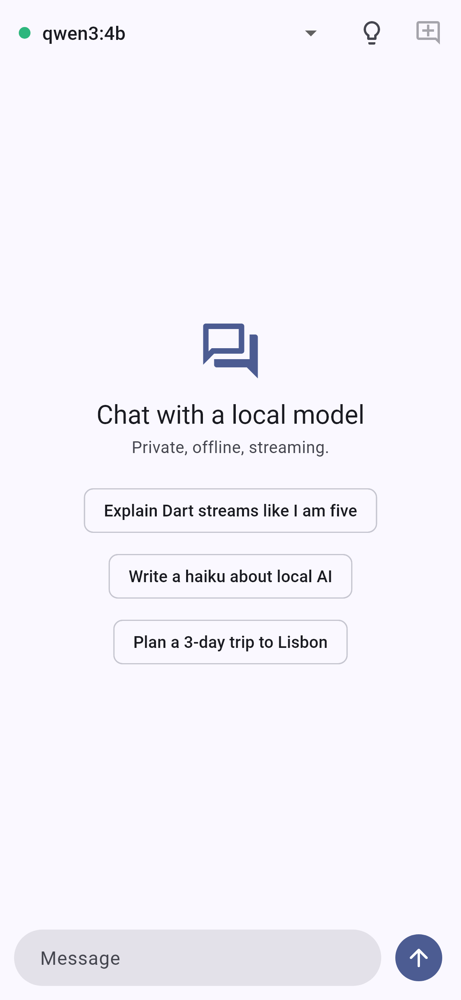

# ollama_easy

[](https://pub.dev/packages/ollama_easy)
[](#platforms)
[](LICENSE)

A complete, typed [Ollama](https://ollama.com) client for Dart and Flutter. Run
local models, a remote server or Ollama cloud with streaming chat, a
**tool-calling loop that runs your Dart functions**, structured outputs
decoded into your classes, thinking, vision, embeddings and full model
management. Cancel tokens, retries, timeouts and interceptors are built in.

Pure Dart: it works on **Android, iOS, web, macOS, Windows and Linux**. On
the web it streams with `fetch`.

```dart
final ollama = Ollama(); // http://localhost:11434

await for (final token in ollama.askStream('Why is the sky blue?')) {
  stdout.write(token);
}
```

<p align="center">
  
  
  
</p>
<p align="center"><sub>The <a href="example/flutter_chat">Flutter chat example</a>: about 400 lines on top of this package.</sub></p>

## Features

| | |
|---|---|
| 💬 **Chat and generate** | Streaming and non-streaming, `.collect()` to merge chunks, final metrics (`tokensPerSecond`) |
| 🛠️ **Tool calling** | `OllamaTool` with a `handler`. `runTools` runs the whole loop: parallel calls, approvals, error recovery, an iteration limit, and a streaming variant with UI events |
| 🧱 **Structured outputs** | `format` as a JSON schema, an `OllamaSchema` builder, `askStructured<T>` / `chatStructured<T>` with one automatic repair retry |
| 🧠 **Thinking** | `think: true` or `OllamaThink.high`, streamed `thinking` deltas |
| 🖼️ **Vision** | `images:` as base64 (data URLs accepted), `OllamaImage.fromBytes` |
| 📐 **Embeddings** | `/api/embed`, `embedMany` with batching and concurrency, `cosineSimilarity` |
| 📦 **Model management** | list, show (capabilities, context length, think levels), pull/push/create with progress, copy, delete, `ps`, load/unload, blobs, version |
| 🗨️ **Conversations** | `OllamaConversation` keeps history, trims by turn (a tool result never loses its call), and saves to and restores from JSON |
| ⛔ **Cancellation** | `OllamaCancelToken`, or just `break` out of the `await for`. Either one closes the socket so the server stops generating |
| 🔁 **Resilience** | Typed exceptions with the server's own message, retries with backoff (`Retry-After` honoured), total and stream-idle timeouts |
| 🔌 **Extensible** | Interceptors (auth, tracing), `OllamaLogInterceptor` (redacts secrets), any `http.Client`, custom headers |
| ☁️ **Cloud and remote** | `Ollama.cloud(apiKey:)`, `Ollama.fromEnvironment()` (`OLLAMA_HOST`, `OLLAMA_API_KEY`), web search/fetch plus ready-made web tools |
| 🔮 **Future-proof** | Every response keeps its `raw` JSON. Unknown message fields round-trip through `extra`. Done reasons and think levels are open types. `ModelOptions(extra:)` sends new keys |

## Install

```yaml
dependencies:
  ollama_easy: ^1.0.0
```

Then [install Ollama](https://ollama.com/download) and pull a model:
`ollama pull qwen2.5:1.5b`.

## Quick start

### Streaming chat

```dart
import 'package:ollama_easy/ollama_easy.dart';

final ollama = Ollama(defaultModel: 'qwen2.5:1.5b');

final stream = ollama.chatStream([
  const OllamaMessage.system('You are a concise assistant.'),
  const OllamaMessage.user('Explain Dart isolates.'),
], options: ModelOptions(temperature: 0.3, numCtx: 8192));

final reply = OllamaChatAccumulator();
await for (final chunk in stream) {
  reply.add(chunk);
  stdout.write(chunk.text); // the thinking deltas are in chunk.thinking
}
print('\n${reply.response.tokensPerSecond?.toStringAsFixed(1)} tok/s');
```

`chatText` / `ask` return a `Future<String>`. `chatTextStream` /
`askStream` stream only the text, and `.collect()` turns any stream into one
merged response.

### Tool calling, with the loop handled for you

```dart
final weather = OllamaTool.function(
  name: 'get_weather',
  description: 'Current temperature for a city',
  parameters: OllamaSchema.object({
    'city': OllamaSchema.string(description: 'City name'),
  }),
  handler: (args) async => {'city': args['city'], 'celsius': 21},
);

final run = await ollama.runTools(
  [const OllamaMessage.user('Is it warmer in Paris or Rome?')],
  tools: [weather],
  approve: (call) => true,        // optional: ask the user first
  maxIterations: 8,
);
print(run.text);                  // final answer
print(run.invocations.length);    // every call that ran
```

`runToolsStream` emits `OllamaToolRunTextDelta`, `OllamaToolRunThinkingDelta`,
`OllamaToolRunCallStarted`, `OllamaToolRunCallFinished` and
`OllamaToolRunDone`, which is everything a chat UI needs. If a handler
throws, the model receives `Error: …` and can recover. Pass
`rethrowToolErrors: true` to make the error surface in your code instead.

### Structured output into your own class

```dart
class City {
  City(this.name, this.population);
  factory City.fromJson(Map<String, Object?> j) =>
      City(j['name'] as String, j['population'] as int);
  final String name;
  final int population;
}

final city = await ollama.askStructured(
  'Tell me about Tokyo.',
  schema: OllamaSchema.object({
    'name': OllamaSchema.string(),
    'population': OllamaSchema.integer(minimum: 0),
  }),
  fromJson: City.fromJson,
);
```

The schema is sent as `format`. If the output doesn't decode (or `fromJson`
throws), the model sees its own mistake and gets one more try. Code fences
and stray text around the JSON are tolerated. `askJson` returns a plain
`Map`.

### Embeddings

```dart
final vectors = await ollama.embedMany(
  documents,                 // List<String>, any length
  model: 'embeddinggemma',
  batchSize: 64,
  concurrency: 2,
  onProgress: (done, total) => print('$done/$total'),
);
final query = await ollama.embedText('local LLMs', model: 'embeddinggemma');
final score = cosineSimilarity(query, vectors.first);
```

### Pulling models with progress

```dart
await ollama.ensureModel('qwen3:4b', onProgress: (status) {
  final pct = status.progress == null ? '' : ' ${(status.progress! * 100).round()}%';
  print('${status.status}$pct');
});

// Or as a stream:
await for (final status in ollama.pullStream('llama3.2')) { /* ... */ }
```

### Thinking and vision

```dart
final answer = await ollama.chat(
  [OllamaMessage.user('What is in this picture?',
      images: [OllamaImage.fromBytes(await File('cat.jpg').readAsBytes())])],
  model: 'qwen2.5vl',
);

await for (final chunk in ollama.chatStream(messages, model: 'qwen3', think: OllamaThink.high)) {
  stdout.write(chunk.thinking ?? '');
}
```

### Conversations

```dart
final chat = ollama.conversation(
  system: 'You are a helpful Flutter mentor.',
  maxMessages: 30,        // and/or maxChars: 24000
  tools: [weather],       // tools with handlers run automatically
);
print(await chat.send('Hi, I am Sam.'));
await for (final delta in chat.sendStream('What is my name?')) {
  stdout.write(delta);
}
final saved = chat.toJson();   // OllamaConversation.fromJson(saved, client: ollama)
```

### Cancelling

```dart
final token = OllamaCancelToken();
stopButton.onPressed = token.cancel;

try {
  await for (final t in ollama.askStream('Write a novel', cancelToken: token)) {
    // ...
  }
} on OllamaCancelledException {
  // stopped by the user
}
```

`break`ing out of the loop, cancelling the subscription or calling
`ollama.close()` also aborts the request.
`OllamaCancelToken.after(Duration)` gives you a per-call deadline.

## Connecting

```dart
Ollama();                                          // http://localhost:11434
Ollama(host: '192.168.1.20');                      // OLLAMA_HOST rules → :11434
Ollama(baseUrl: Uri.parse('https://gpu.example.com/ollama'));  // behind a proxy
Ollama.androidEmulator();                          // the host machine, 10.0.2.2
Ollama.cloud(apiKey: 'sk-...');                    // https://ollama.com
Ollama.fromEnvironment();                          // OLLAMA_HOST + OLLAMA_API_KEY

Ollama(
  apiKey: 'token',                                 // Authorization: Bearer token
  headers: {'X-Team': 'mobile'},
  timeout: const Duration(minutes: 10),            // whole call / first byte of a stream
  streamIdleTimeout: const Duration(minutes: 5),   // max gap between chunks
  retryPolicy: const OllamaRetryPolicy(maxRetries: 3),
  interceptors: [OllamaLogInterceptor(logBody: true)],
  httpClient: myClient,                            // e.g. cupertino_http, cronet_http
  defaultOptions: ModelOptions(numCtx: 8192),
  defaultKeepAlive: const Duration(minutes: 30),
);
```

Interceptors can change the URI, headers and body of every attempt. They're
handy for refreshing tokens:

```dart
OllamaCallbackInterceptor(onRequest: (request) async {
  request.headers['Authorization'] = 'Bearer ${await auth.token()}';
});
```

## Errors

Every error is an `OllamaException`, so one `catch` handles them all. Catch
a subtype to handle one case:

```dart
try {
  await ollama.chat(messages, model: 'llama9');
} on OllamaNotFoundException catch (e) {        // 404: "model 'llama9' not found"
  await ollama.pull('llama9');
} on OllamaRateLimitException catch (e) {       // 429, e.retryAfter
} on OllamaConnectionException {                // server unreachable
} on OllamaTimeoutException {
} on OllamaStreamException catch (e) {          // the server failed mid-stream
} on OllamaException catch (e) {                // anything else (e.statusCode, e.body)
}
```

Retries happen only *before* any data reaches you, so a stream never repeats
tokens.

## Platforms

| Android | iOS | Web | macOS | Windows | Linux |
|:---:|:---:|:---:|:---:|:---:|:---:|
| ✅ | ✅ | ✅ | ✅ | ✅ | ✅ |

- **Web:** start Ollama with `OLLAMA_ORIGINS="*"` (or your origin) so the
  browser may call it. Responses stream with `fetch`, and aborting really
  closes the connection.
- **Android emulator:** use `Ollama.androidEmulator()`. A real device needs
  your computer's LAN IP, with Ollama started using `OLLAMA_HOST=0.0.0.0`.
- **macOS apps:** enable the *Outgoing Connections (Client)* entitlement.
- **iOS / Android, plain `http://` to a LAN IP:** add an ATS exception
  (iOS) or allow cleartext traffic (Android).

## Comparison

| | ollama_easy | ollama_dart | ollama | langchain_ollama |
|---|:---:|:---:|:---:|:---:|
| Streaming chat and generate | ✅ | ✅ | ✅ | ✅ |
| Tool loop that runs your functions | ✅ | ❌ | ❌ | via agents |
| Typed structured output with repair | ✅ | schema only | ❌ | via parsers |
| Per-request cancel tokens | ✅ | partial | ❌ | ❌ |
| Retries, timeouts, interceptors | ✅ | partial | ❌ | ❌ |
| Conversation helper with safe trimming | ✅ | ❌ | ❌ | memory classes |
| Pull/push/create progress | ✅ | partial | ❌ | ❌ |
| Web search/fetch and web tools | ✅ | ✅ | ❌ | ❌ |
| Dependencies | `http` | several | `http` | LangChain |

The full gap analysis, and what's planned next, is in
[RESEARCH.md](RESEARCH.md).

## Command line

```bash
dart pub global activate ollama_easy
ollama_easy "Tell me a joke"           # one prompt
ollama_easy -m llama3.2 --think        # interactive chat (/clear, /exit)
```

## Examples

- [`example/ollama_easy_example.dart`](example/ollama_easy_example.dart): a
  CLI tour of streaming, tools, structured output, conversation,
  embeddings, cancel, and pull progress.
- [`example/flutter_chat`](example/flutter_chat): the Flutter app in the
  screenshots.

## Testing

```bash
dart test                         # 106 tests: mock server, real sockets, FakeAsync
dart test -p chrome               # the same suite in a browser
dart test -t integration          # against a real Ollama (skips if none is running)
```

## Migrating from 0.2

1.0 is source compatible with 0.2, so existing calls compile unchanged. A
few behaviours changed, which is why the major version went up:

- A `{"error": ...}` line in a stream now **throws `OllamaStreamException`**.
  Before, it was silently passed on as an empty chunk.
- Errors are subclasses of `OllamaException` (`OllamaNotFoundException`, …).
  `catch (OllamaException)` still catches everything.
- `null` values inside `format` schemas, tool arguments and `options` are
  now **sent**. Only top-level nulls are dropped.
- `hasModel('llama3')` now matches `llama3:latest`.
- `pull()` uses the streaming endpoint, so long downloads don't hit the
  request timeout. It takes an optional `onProgress`.
- `keepAlive` accepts a `Duration`, a number or a string (it used to accept
  only a string).
- Requests now have default timeouts (10 minutes; 5 minutes idle between
  stream chunks) and two automatic retries on connection errors and
  429/502/503/504. Pass `timeout: null` or `retryPolicy:
  OllamaRetryPolicy.none` to opt out.
- `http` ^1.5.0 is required. That version gives real streaming on the web
  and request aborts.
